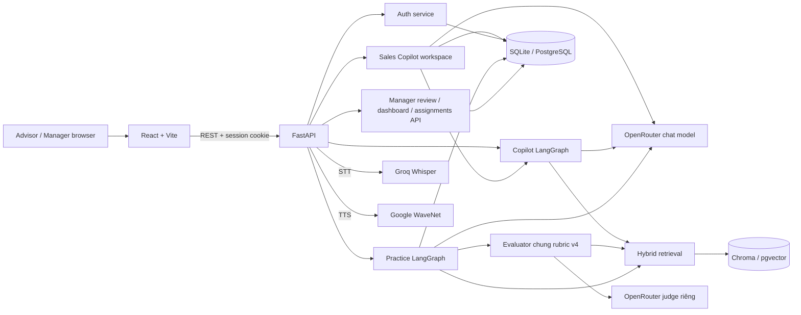
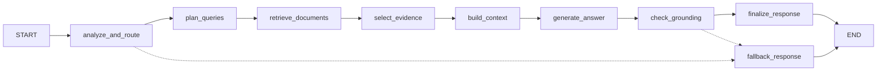
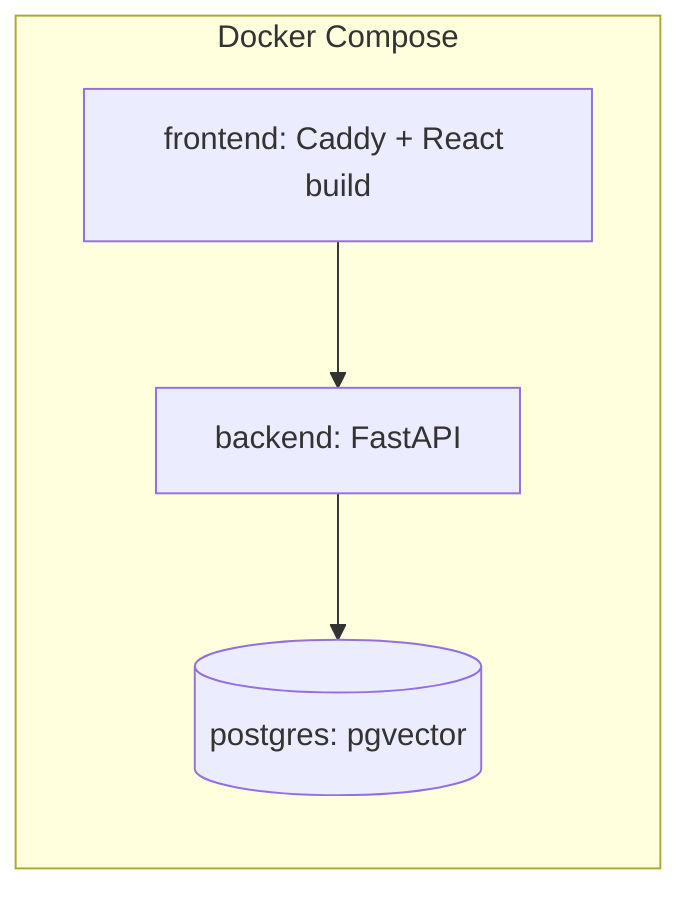

# Architecture Document

## System Overview

P-043 là AI Sales Coach cho tư vấn viên VinFast: frontend React/Vite gọi backend FastAPI bằng REST và cookie phiên. Backend phục vụ hai phân hệ: **Sales Copilot** (hội thoại theo khách, hồ sơ/tóm tắt có tin nguồn, hỏi đáp lịch sử, nháp trả lời theo bối cảnh và văn phong sales, công việc/lịch hẹn) và **Practice/Role-play** (AI Customer nhiều lượt, AI judge chấm theo rubric có evidence, manager duyệt). Trong Sales Copilot, graph LangGraph tra cứu có nguồn là một workflow; Customer Intelligence, soạn nháp và lịch biểu là các service riêng. Dữ liệu người dùng, phiên, transcript và điểm lưu trong SQL (SQLite hoặc PostgreSQL); vector index dùng Chroma hoặc pgvector. Sơ đồ đầy đủ, gồm cả luồng giọng nói, nằm ở [docs/architecture_diagram.md](docs/architecture_diagram.md).

## Architecture Diagram

## Components

### 1. Frontend (React + Vite)
- **Purpose:** giao diện Advisor với ba tab **Trợ lý Co-pilot** (Dashboard, Khách hàng, Lịch sự kiện), **Phòng luyện tập** (điểm và radar kỹ năng, bài được giao, thư viện tình huống, lịch sử) và **Kho kiến thức** (dòng xe, tài liệu có ngày hiệu lực, tài liệu gốc/PDF); Manager console với **Tổng quan**, **Giao bài**, **Lịch sử luyện tập**, **Tài khoản**. Code ở `frontend/src/components/` (`copilot`, `roleplay`, `knowledge`, `manager`, `charging`, `layout`, `auth`, `common`).
- **Key Features:** không gian tư vấn theo khách có tra cứu trích nguồn và mở tài liệu gốc; Practice Room chọn **Nhắn tin** hoặc **Gọi thoại** (push-to-talk tối đa 90 giây, giữ phím Space, công tắc **Tự động gửi**), Mirror camera cục bộ không ghi hình; scorecard 5 kỹ năng có trích dẫn và đối chiếu thông tin với Kho kiến thức; manager dashboard (bản đồ kỹ năng, điểm đội 8 tuần, so sánh điểm AI với điểm đã duyệt), modal duyệt bài sửa điểm kèm lý do. `NoticeDialog.jsx` và `practiceNotices.js` ánh xạ mã lỗi Practice thành thông báo/hành động tiếng Việt.
- **State Management:** React 19 hooks (`frontend/src/hooks`), lời gọi API tập trung ở `frontend/src/api/` (`authApi`, `copilotApi`, `practiceApi`, `managerApi`); không dùng thư viện state ngoài (xem `frontend/package.json`).
- **Build/serve:** Vite 8; image Docker dùng Caddy (`frontend/Caddyfile`) phục vụ file tĩnh và proxy `/api/*`, `/health`, `/ready` sang backend; trên Vercel dùng `frontend/vercel.mjs` tạo rewrites.

### 2. Backend (FastAPI)
- **Purpose:** `src/main.py` lắp router auth, Copilot (`/copilot`), Sales Copilot workspace (`/sales-copilot`, `src/api/sales_copilot.py`) và bộ router Practice/manager từ `src/api/recorded_practice.py` (voice, history, progress, assignments, review, dashboard, todos); CORS theo `CORS_ORIGINS`; middleware telemetry cho Copilot.
- **API Design:** RESTful dưới `/api/v1`, Swagger ở `/docs`, liveness ở `/health`, readiness (manifest index) ở `/ready`. Nhóm endpoint chính:
  - `/copilot`: `query`, `query/stream` (SSE `status`, `delta`, `insights`, `final`, `error`), `knowledge`, `sessions`, `sources/{document_id}`.
  - `/sales-copilot`: `conversations` (tin nhắn, `analyze`, `draft`, `copilot-chat/stream`, `profile-fact`, `lead-stage`, `tasks`), `customers/{id}/intelligence`, `dashboard`, `calendar`, `tasks`, `preferences`.
  - `/practice`: `scenarios`, `sessions`, `{id}/message`, `{id}/retry-reply`, `{id}/voice/transcribe`, `{id}/voice/speech`, `{id}/finish`, `{id}/result`, `history`, `progress`, `assignments`.
  - `/manager`: `reviews`, `reviews/{id}` (GET, PATCH), `attempts`, `overview`, `dashboard`, `advisors`, `assignments`, `todos`.
- **Authentication:** cookie phiên HTTP-only (`src/services/auth.py`, mật khẩu băm PBKDF2-SHA256); role `advisor` và `manager`. Copilot và thao tác luyện tập giới hạn Advisor; danh mục scenario cho Advisor/Manager; review giới hạn Manager.
- **Lỗi Practice:** [practice_errors.py](src/api/practice_errors.py) trả `{detail, code}` với thông báo tiếng Việt và mã ổn định như `session_busy`, `provider_unavailable`, `evaluation_failed`, `voice_too_long`. UI dùng notice dialog để retry, đăng nhập lại hoặc chuyển về nhập chữ tùy lỗi.
- **Runtime guard:** Copilot có admission control và giới hạn tốc độ (`COPILOT_RATE_LIMIT`, `src/agents/copilot/runtime.py`).

### 3. AI Agents (LangGraph)

**Workflow tra cứu có nguồn trong Sales Copilot** (`src/agents/copilot/graph.py`)
- **Agent Type:** Custom state graph với conditional edges.
- **Nodes:** `analyze_and_route` → `plan_queries` → `retrieve_documents` → `select_evidence` → `build_context` → `generate_answer` → `check_grounding` → `finalize_response`, cùng nhánh `fallback_response`.
- **Validation:** kiểm tra citation, claim và excerpt trong `src/agents/copilot/validation/`; thiếu evidence thì abstain, provider lỗi thì trả lỗi để retry.

Luồng chính rút gọn dưới đây; graph thực còn có nhánh bỏ qua retrieval, corrective retrieval và regeneration có giới hạn trong [graph.py](src/agents/copilot/graph.py).

**Practice / Role-play** (`src/agents/roleplay/`)
- **Nodes (turn graph):** `route_pending_turn`, `analyze_advisor_turn`, `update_customer_state`, `persist_advisor_turn`, `customer_turn`, `persist_customer_turn`.
- **State:** `state.py`, `state_reducer.py`; checkpoint SQL theo `session_id` qua `SQLCheckpointRepository`, giới hạn lượt, giữ hidden facts của khách. Start session chỉ khởi tạo/lưu state; **Advisor mở lời trước**, không có lượt khách tự chào khi tạo phiên. Lưu lượt Advisor trước khi gọi Customer; khi provider lỗi có thể retry phản hồi đang chờ.
- **Customer & analyzer:** `customer_agent.py` và `turn_analyzer.py` dùng generator cấu hình qua `LLM_PROVIDER` / `OPENROUTER_MODEL_NAME` khi dùng OpenRouter.
- **Judge riêng:** `PRACTICE_JUDGE_PROVIDER` và `PRACTICE_JUDGE_MODEL`; mặc định OpenRouter / `deepseek/deepseek-v3.2`, temperature 0. [practice_runtime.py](src/integrations/practice_runtime.py) từ chối cấu hình judge trùng cả provider/model với generator.
- **Evaluator chung:** [evaluator.py](src/agents/roleplay/evaluator.py) đọc scenario + final state + transcript + knowledge evidence và nhận `current_policy_evidence` (document ID, version, quote) từ resolver thay cho số liệu chính sách trong scenario, không có evaluator riêng cho từng kịch bản. [Prompt hiện hành](src/agents/roleplay/prompts/evaluator.py) là `sales-rubric-v4`: Need Discovery, Product Knowledge, Objection Handling, Policy Accuracy, Closing / Next Step. Điểm 1–3 cho tiêu chí `assessed`; `unassessed` có điểm null. Code kiểm tra message ID, quote chính xác và nguồn factual findings; điểm tổng là trung bình tiêu chí đã chấm. `policy_expectations` từng scenario định hướng chấm chính sách, bắt buộc chấm khi Advisor đã thảo luận chính sách/giá phù hợp điều kiện code. Độ tin cậy judge v4 so với nhãn chuyên gia: [judge_calibration_v4_compare_2026-10-18.md](eval/reports/judge_calibration_v4_compare_2026-10-18.md).
- **Chính sách theo corpus:** `policy_expectations` chỉ chứa `topic` tiếng Việt không có số liệu chính sách + `lookup` (`query`, `document_type`, `policy_type`, `product_model`); analyzer/customer chỉ thấy topic. [ScenarioPolicyResolver](src/integrations/practice_policy.py) tra corpus theo ngày tạo phiên (giờ Việt Nam); phiên cũ thiếu `created_at` dùng `started_at` của attempt, sau đó mới dùng hôm nay kèm warning. Vì `expiry_date` trong corpus trống, `PolicyWindowIndex` đọc cửa sổ “Thời gian áp dụng” từ từng mục đánh số của tài liệu đầy đủ, áp dụng cho mọi chunk trong mục; lọc `policy_type` trước top-k. Không có nguồn hợp lệ → `not_applicable`, judge không bắt buộc chính sách đó; claim verification dùng cùng ngày, startup cảnh báo từng expectation chưa tìm được nguồn.
- **Bốn kịch bản:** [scenarios.json](data/scenarios/scenarios.json) gồm `SCENARIO_01_VF5_TAXI`, `SCENARIO_02_VF7_VS_CX5`, `SCENARIO_03_VF6_APARTMENT`, `SCENARIO_04_VF6_ECO_PLUS_UPSELL`. Kịch bản 04 chấp nhận `close_eco` hoặc `upsell_plus`; Plus là kết quả ưu tiên, yêu cầu giải quyết `OBJ_VF6_PLUS_WORTH`, không ép mọi phiên phải upsell.
- **Guardrail hai lớp:** [guardrails.py](src/agents/roleplay/guardrails.py) lọc cục bộ trước model; analyzer phát hiện ngữ nghĩa qua `unsafe_or_abusive`. [graph.py](src/agents/roleplay/graph.py) và [state_reducer.py](src/agents/roleplay/state_reducer.py) đưa phiên về `advisor_misconduct`, kết thúc trao đổi; evaluator ép điểm đã chấm về 1. Đây là cơ chế giảm rủi ro, không phải bảo đảm phát hiện mọi hành vi sai phạm.

**Sales Copilot workspace** (`src/api/sales_copilot.py`, `src/services/`)
- **Hội thoại theo khách:** `sales_conversation_service.py`, `sales_copilot_repository.py`; tra cứu trong hội thoại gọi Copilot graph và trả citation như Copilot độc lập (`copilot-chat/stream`).
- **Tóm tắt và hỏi đáp lịch sử:** tổng hợp hồ sơ, tình hình, chủ đề đã trao đổi/còn mở và hỏi đáp trên lịch sử với dẫn chứng tin nhắn; phân tích có phiên bản, không chỉ trả lời câu hỏi từ corpus.
- **Phân tích khách có kiểm chứng:** `intelligence_engine.py` tạo phân tích có phiên bản, mỗi dữ kiện gắn tin nhắn nguồn; `customer_intelligence.py` kiểm tra trình bày; snapshot lưu ở `customer_intelligence_store.py`. Sales xác nhận/sửa dữ kiện (`profile-fact`) và duyệt đề xuất (`proposals/{id}/review`); hệ thống không tự chuyển trạng thái lịch.
- **Nháp trả lời, công việc, lịch:** `sales_copilot_assistant.py` (nháp, gợi ý công việc từ tin nhắn), `sales_agenda_service.py` (dashboard, lịch, phát hiện lịch trùng).
- **Bảo vệ dữ liệu khách:** `customer_pii.py` giả danh hoá PII theo từng khách trước khi gửi model, bản đồ PII mã hoá trong store; không có fallback plaintext và không đưa vào tracing.
- **Cache:** `semantic_cache.py` cache khớp chính xác cho câu hỏi Copilot độc lập, bỏ qua câu phụ thuộc ngữ cảnh khách.

### 4. Database
- **Type:** SQLite mặc định khi chạy Python trực tiếp; PostgreSQL (local qua Docker Compose, hoặc hosted) khi đặt `DATABASE_URL`. Truy cập bằng SQLAlchemy 2 và `psycopg`.
- **Data:** users/sessions (`auth_repository.py`), Copilot sessions (`copilot_sessions.py`), hội thoại/khách/công việc của Sales Copilot (`sales_copilot_repository.py`), phân tích khách có phiên bản và bản đồ PII mã hoá (`customer_intelligence_store.py`), practice attempts/transcript/điểm/review, bài giao và việc cần làm của Manager (`practice_records.py`, `practice_persistence.py`), mức dùng giọng nói (`voice_usage.py`, bảng `practice_voice_usage`).
- **Migrations:** bảng được tạo khi khởi động; SQL cho pgvector và thay đổi schema ở `scripts/migrations/`, migration dữ liệu phân tích khách ở `src/integrations/intelligence_migration.py`. Cấu hình database theo môi trường: [docs/deployment.md](docs/deployment.md).

### 5. Vector Store
- **Type:** Chroma (`CHROMA_PERSIST_DIR`) khi chạy trực tiếp; pgvector (`VECTOR_STORE_TYPE=pgvector`, `src/knowledge/pgvector_store.py`) trong Docker và triển khai hosted.
- **Embeddings:** `openai/text-embedding-3-small` qua OpenRouter (`EMBEDDING_MODEL_NAME`).
- **Purpose:** cung cấp evidence sản phẩm/chính sách cho workflow tra cứu trong Sales Copilot và tri thức cho service soạn nháp trả lời khách. Graph chạy dense + BM25 từ `src/agents/copilot/nodes/retrieval.py`; selector `src/agents/copilot/nodes/evidence.py` dùng fusion RRF trong `src/agents/copilot/tools.py`, chọn evidence/Jev, đóng gói context và kiểm tra claims trước khi công bố. Service nháp `src/services/sales_copilot_assistant.py` gọi `RetrievalService` riêng; không đồng nhất đường này với toàn bộ graph.
- **Ranh giới dữ liệu:** `data/knowledge/corpus.json` là nguồn tri thức, vector index là dữ liệu dẫn xuất, ingest khi index rỗng. Hồ sơ khách, hội thoại, tóm tắt có phiên bản, công việc và lịch hẹn lưu trong SQL; phân tích/tóm tắt khách dựa trên tin nhắn nguồn, không phải vector search trên corpus xe. Chi tiết tại [workflow Copilot §7](docs/copilot-workflow.md).

### 6. Voice (STT/TTS)
- Frontend → bản ghi tối đa 90 giây → FastAPI → Groq `whisper-large-v3-turbo` → bản chép tiếng Việt → frontend. **Tự động gửi** bật: gửi bản chép thành lượt Advisor; tắt: sửa rồi Gửi.
- Văn bản Customer đã lưu → FastAPI → Google Cloud WaveNet tiếng Việt → audio phát trên frontend; provider key ở server, usage lưu SQL (`src/services/voice.py`, `src/integrations/voice_usage.py`). Cả hai tùy chọn; chat chữ chạy khi thiếu key. Chi tiết: [docs/voice-mode.md](docs/voice-mode.md).

### 7. Observability
- Logging và telemetry Copilot ở `src/observability.py` (request ID `X-Request-ID`, `redact()` che key, email, số điện thoại, URL database trong log và input/output LangSmith); LangSmith bật bằng `LANGSMITH_TRACING`.
- Practice có project LangSmith riêng ([roleplay_tracing.py](src/roleplay_tracing.py), biến `ROLEPLAY_LANGSMITH_*`) để trace start, từng lượt và evaluation, tách khỏi Copilot; mặc định không ghi nội dung hội thoại.
- **Kiểm tra độ phủ tri thức:** [scripts/check_scenario_knowledge.py](scripts/check_scenario_knowledge.py) chạy offline, không embeddings/network; `--date` mặc định hôm nay giờ Việt Nam. Bảng theo kịch bản/chính sách hiển thị ✅, ⚠️ chỉ có nguồn hết hạn, ❌ thiếu nguồn hoặc ⚠️ nguồn đang hiệu lực mâu thuẫn; exit khác 0 nếu chính sách `expected` không có nguồn hợp lệ. [Pytest wrapper](tests/test_integrations/test_scenario_knowledge_coverage.py) kiểm tra corpus theo ngày hiện tại.

## Data Flow

1. Người dùng đăng nhập; cookie phiên HTTP-only được đặt.
2. Frontend gửi request tới `/api/v1/...`; FastAPI kiểm tra quyền và validate bằng Pydantic.
3. Workflow tra cứu trong Sales Copilot: graph lập truy vấn, truy xuất evidence từ vector index + lexical, sinh câu trả lời qua OpenRouter, kiểm tra grounding/citation rồi trả về kèm nguồn.
4. Practice: Advisor mở lời → guardrail → analyzer → state reducer → checkpoint SQL → AI Customer → checkpoint SQL → frontend. Khi kết thúc: transcript + scenario + knowledge evidence → judge riêng → validation → điểm AI dự thảo lưu SQL.
5. HITL: Manager xem hàng đợi → transcript/evidence và điểm AI → sửa/duyệt kèm lý do → SQL lưu kết quả đã duyệt → tiến độ Advisor, bản đồ kỹ năng và điểm đội 8 tuần → Manager giao bài tiếp (`/manager/assignments`), Advisor thấy trong "Bài được giao". Kết quả AI không tự trở thành phê duyệt quản lý.
6. Sales Copilot: Advisor mở khách → tin nhắn + phân tích có tin nguồn (PII đã giả danh hoá trước khi gọi model) → tra cứu/nháp trả lời → Advisor chỉnh và xác nhận → công việc/lịch hẹn lưu SQL.

## Deployment Architecture

- **Local:** `docker-compose.yml` chạy 3 service (`postgres` với volume `postgres_data`, `backend`, `frontend` cổng 3000).
- **Hosted:** backend Docker từ `Dockerfile` trên Render, frontend Vite trên Vercel (rewrites `/api` qua `frontend/vercel.mjs`), PostgreSQL + pgvector trên Neon. Live URL: https://aisale.itup.io.vn/. Xem [docs/deployment.md](docs/deployment.md).
- **Self-hosted production:** `docker-compose.prod.yml` dừng ngay nếu thiếu `POSTGRES_PASSWORD`, `OPENROUTER_API_KEY` hoặc `CORS_ORIGINS`; image backend chạy user không phải root và có healthcheck `/health`.
- **Cấu hình local:** Compose dùng PostgreSQL + pgvector; judge Practice dùng mặc định `PRACTICE_JUDGE_*` trong `src/config.py`. Xem [Setup README](README.md); `.env` của host không tự được đưa toàn bộ vào container.
- **CI:** [.github/workflows/ci.yml](.github/workflows/ci.yml) cài `requirements.lock`, chạy Ruff và pytest backend trên push/PR tới `main`/`develop`.

## Security

- Khóa API nằm trong `.env`/secret của host, không commit.
- Validate input bằng Pydantic; cookie phiên HTTP-only, CORS giới hạn theo `CORS_ORIGINS`.
- Phân quyền theo role (Advisor/Manager); không cho seed tài khoản demo ở production.
- Rate limiting và admission control cho Copilot; giới hạn lượt theo kịch bản và giới hạn 90 giây mỗi lượt giọng nói cho Practice; usage giọng nói được đo theo phiên.
- PII khách hàng được giả danh hoá trước khi gọi model; `redact()` che dữ liệu nhạy cảm trong log và trace.
- Guardrail hai lớp cho role-play kết thúc phiên khi Advisor dùng ngôn từ không phù hợp; AI Customer có kiểm tra rò rỉ prompt và lệch ngôn ngữ.
- Kiểm thử prompt injection: `eval/prompt_injection/`, báo cáo `eval/reports/prompt_injection_isolated_2026-10-13.md` và `eval/reports/roleplay_multilingual_injection_2026-10-13.md` (0 lộ canary, 0 tái hiện system prompt).

## Design Decisions

| Quyết định | Lựa chọn | Lý do |
|----------|--------|--------|
| Framework | FastAPI | Bất đồng bộ, tự sinh tài liệu API (Swagger), kiểm tra kiểu dữ liệu |
| Agent | LangGraph | Quản lý state và conditional routing rõ ràng; Practice cần checkpoint theo phiên |
| Chính sách kịch bản | Topic + lookup từ corpus; giữ thông số sản phẩm trong scenario | Hardcode giá/khuyến mãi/chính sách có thể phạt tư vấn viên tư vấn đúng khi corpus thay đổi; validator chặn số liệu chính sách trong topic, phản đối, điều kiện giải quyết và outcome, cho phép dữ kiện riêng của khách (ngân sách, quãng đường); `upsell_benefits` giữ thông số sản phẩm để phục vụ tình huống upsell |
| Database | SQLite (dev) / PostgreSQL (Docker, hosted) | SQLite chạy nhanh không cần dịch vụ; PostgreSQL dùng chung một nơi lưu và hỗ trợ pgvector |
| Vector store | Chroma / pgvector | Chroma đơn giản cho local; pgvector gom SQL và vector vào một database khi triển khai |
| Frontend | React + Vite | Build nhanh, SPA gọi REST; deploy tĩnh trên Vercel hoặc Caddy |
| LLM gateway | OpenRouter | Một API key cho cả chat và embedding, dễ đổi model |
| Voice | Groq Whisper + Google WaveNet | STT tiếng Việt và giọng đọc nam/nữ theo kịch bản; đặt phía server để không lộ key |
