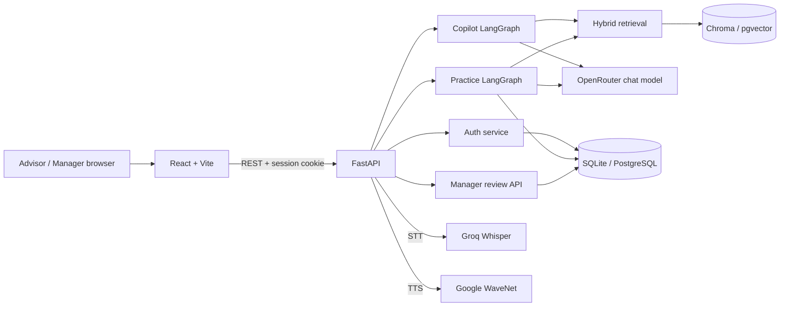
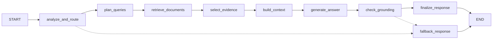
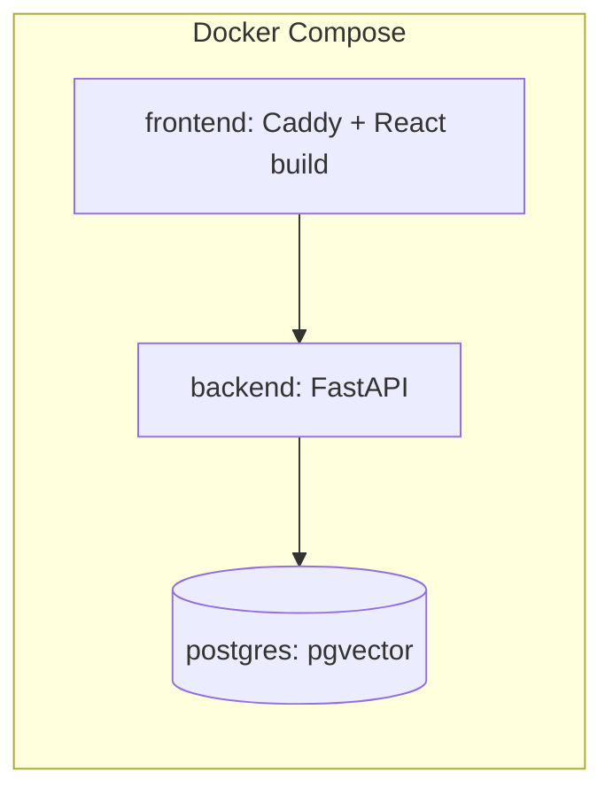

# Architecture Document

## System Overview

P-043 là AI Sales Coach cho tư vấn viên VinFast: frontend React/Vite gọi backend FastAPI bằng REST và cookie phiên. Backend có hai agent LangGraph: **Copilot** (RAG có trích nguồn trên corpus công khai) và **Practice/Role-play** (AI Customer nhiều lượt, AI judge chấm theo rubric có evidence, manager duyệt). Dữ liệu người dùng, phiên, transcript và điểm lưu trong SQL (SQLite hoặc PostgreSQL); vector index dùng Chroma hoặc pgvector. Sơ đồ đầy đủ, gồm cả luồng giọng nói, nằm ở [docs/architecture_diagram.md](docs/architecture_diagram.md).

## Architecture Diagram

## Components

### 1. Frontend (React + Vite)
- **Purpose:** giao diện Advisor (Copilot, Knowledge, Practice Room, Progress, Charging) và Manager console (giao bài, hàng đợi review, năng lực đội). Code ở `frontend/src/components/` (`copilot`, `roleplay`, `knowledge`, `manager`, `progress`, `charging`, `auth`, ...).
- **Key Features:** chat Copilot có citation, Practice Room với micro/Voice Mode, màn hình manager.
- **State Management:** React 19 hooks (`frontend/src/hooks`), lời gọi API tập trung ở `frontend/src/api/` (`authApi`, `copilotApi`, `practiceApi`, `managerApi`); không dùng thư viện state ngoài (xem `frontend/package.json`).
- **Build/serve:** Vite 8; image Docker dùng Caddy (`frontend/Caddyfile`) phục vụ file tĩnh và proxy `/api/*`, `/health`, `/ready` sang backend; trên Vercel dùng `frontend/vercel.mjs` tạo rewrites.

### 2. Backend (FastAPI)
- **Purpose:** `src/main.py` lắp router `auth`, `copilot`, `practice`, `recorded_practice` (voice) và manager; CORS theo `CORS_ORIGINS`; middleware telemetry cho Copilot.
- **API Design:** RESTful dưới `/api/v1`, Swagger ở `/docs`, liveness ở `/health`.
- **Authentication:** cookie phiên HTTP-only (`src/services/auth.py`, mật khẩu băm PBKDF2-SHA256); role `advisor` và `manager`. Practice giới hạn Advisor, review giới hạn Manager.
- **Runtime guard:** Copilot có admission control và giới hạn tốc độ (`COPILOT_RATE_LIMIT`, `src/agents/copilot/runtime.py`).

### 3. AI Agents (LangGraph)

**Copilot** (`src/agents/copilot/graph.py`)
- **Agent Type:** Custom state graph với conditional edges.
- **Nodes:** `analyze_and_route` → `plan_queries` → `retrieve_documents` → `select_evidence` → `build_context` → `generate_answer` → `check_grounding` → `finalize_response`, cùng nhánh `fallback_response`.
- **Validation:** kiểm tra citation, claim và excerpt trong `src/agents/copilot/validation/`; thiếu evidence thì abstain, provider lỗi thì trả lỗi để retry.

**Practice / Role-play** (`src/agents/roleplay/`)
- **Nodes (turn graph):** `route_pending_turn`, `analyze_advisor_turn`, `update_customer_state`, `persist_advisor_turn`, `customer_turn`, `persist_customer_turn`.
- **State:** `state.py`, `state_reducer.py`; checkpoint theo `session_id`, giới hạn lượt, giữ hidden facts của khách.
- **Customer & Judge:** `customer_agent.py` (AI Customer), `turn_analyzer.py`, `evaluator.py` (rubric + transcript evidence, đối chiếu claim với nguồn). Rubric mô tả ở [docs/rubric_specification.md](docs/rubric_specification.md). Kịch bản nằm ở `data/scenarios/scenarios.json`.

### 4. Database
- **Type:** SQLite mặc định khi chạy Python trực tiếp; PostgreSQL (local qua Docker Compose, hoặc hosted) khi đặt `DATABASE_URL`. Truy cập bằng SQLAlchemy 2 và `psycopg`.
- **Data:** users/sessions (`auth_repository.py`), Copilot sessions (`copilot_sessions.py`), practice attempts/transcript/điểm/review (`practice_records.py`, `practice_persistence.py`), mức dùng giọng nói (`voice_usage.py`, bảng `practice_voice_usage`).
- **Migrations:** chưa có framework migration; bảng được tạo khi dùng, có một SQL thủ công ở `scripts/migrations/`. Xem [docs/database-backends.md](docs/database-backends.md).

### 5. Vector Store
- **Type:** Chroma (`CHROMA_PERSIST_DIR`) khi chạy trực tiếp; pgvector (`VECTOR_STORE_TYPE=pgvector`, `src/knowledge/pgvector_store.py`) trong Docker và triển khai hosted.
- **Embeddings:** `openai/text-embedding-3-small` qua OpenRouter (`EMBEDDING_MODEL_NAME`).
- **Purpose:** RAG cho Copilot; retrieval kết hợp vector và lexical (`rank-bm25`) trong `src/knowledge/retrieval_service.py`. Nguồn gốc là `data/knowledge/corpus.json`, index chỉ là dữ liệu dẫn xuất, ingest khi index rỗng.

### 6. Voice (STT/TTS)
- Server-side transcription bằng Groq Whisper Large V3 Turbo, phát giọng khách bằng Google Cloud WaveNet tiếng Việt (`src/services/voice.py`). Cả hai tùy chọn; chat chữ chạy khi thiếu key. Chi tiết: [docs/voice-mode.md](docs/voice-mode.md).

### 7. Observability
- Logging và telemetry Copilot ở `src/observability.py` (request ID `X-Request-ID`); LangSmith bật bằng `LANGSMITH_TRACING`.

## Data Flow

1. Người dùng đăng nhập; cookie phiên HTTP-only được đặt.
2. Frontend gửi request tới `/api/v1/...`; FastAPI kiểm tra quyền và validate bằng Pydantic.
3. Copilot: graph lập truy vấn, truy xuất evidence từ vector index + lexical, sinh câu trả lời qua OpenRouter, kiểm tra grounding/citation rồi trả về kèm nguồn.
4. Practice: mỗi lượt Advisor được phân tích, cập nhật state khách, AI Customer phản hồi; transcript lưu vào SQL. Khi kết thúc, evaluator chấm điểm dự thảo kèm evidence.
5. Manager xem hàng đợi, sửa/duyệt điểm kèm lý do; điểm đã duyệt đưa vào bảng năng lực đội ngũ.

## Deployment Architecture

- **Local:** `docker-compose.yml` chạy 3 service (`postgres` với volume `postgres_data`, `backend`, `frontend` cổng 3000).
- **Hosted:** backend là Docker web service từ `Dockerfile` (Render), frontend là project Vite trên Vercel, database PostgreSQL + pgvector hosted. Xem [docs/deployment.md](docs/deployment.md).

## Security

- Khóa API nằm trong `.env`/secret của host, không commit.
- Validate input bằng Pydantic; cookie phiên HTTP-only, CORS giới hạn theo `CORS_ORIGINS`.
- Phân quyền theo role (Advisor/Manager); không cho seed tài khoản demo ở production.
- Rate limiting và admission control cho Copilot.
- Kiểm thử prompt injection cho role-play nằm trong `tests/` và `eval/results/`.

## Design Decisions

| Decision | Choice | Reason |
|----------|--------|--------|
| Framework | FastAPI | Async, auto-docs, type-safe |
| Agent | LangGraph | Quản lý state và conditional routing rõ ràng; Practice cần checkpoint theo phiên |
| Database | SQLite (dev) / PostgreSQL (Docker, hosted) | SQLite chạy nhanh không cần dịch vụ; PostgreSQL dùng chung một nơi lưu và hỗ trợ pgvector |
| Vector store | Chroma / pgvector | Chroma đơn giản cho local; pgvector gom SQL và vector vào một database khi triển khai |
| Frontend | React + Vite | Build nhanh, SPA gọi REST; deploy tĩnh trên Vercel hoặc Caddy |
| LLM gateway | OpenRouter | Một API key cho cả chat và embedding, dễ đổi model |
| Voice | Groq Whisper + Google WaveNet | STT tiếng Việt và giọng đọc nam/nữ theo kịch bản; đặt phía server để không lộ key |
