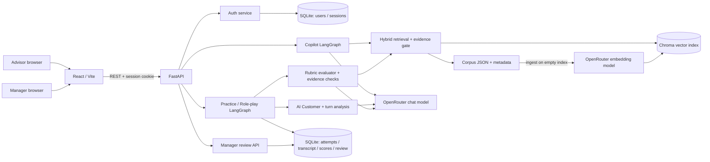

# P-043 MVP architecture — Gate 2

## Luồng và quyền

1. `POST /api/v1/auth/login` đặt HTTP-only cookie. Practice giới hạn Advisor; review giới hạn Manager. **Copilot routes trên `develop` chưa được bảo vệ bởi Advisor auth**; phần hardening ở nhánh riêng.
2. Copilot nhận `/api/v1/copilot/query`, tìm evidence từ corpus/Chroma và lexical retrieval, lọc theo metadata, tạo câu trả lời trích nguồn hoặc abstain/lỗi. `/api/v1/copilot/sources/{document_id}` mở tài liệu gốc.
3. Advisor chọn scenario JSON, trao đổi nhiều lượt với AI Customer, kết thúc rõ ràng. State machine giới hạn lượt, bảo vệ hidden facts; evaluator chấm kỹ năng bán hàng với transcript evidence và đối chiếu claim thực tế với nguồn.
4. SQLite lưu ownership, transcript, AI draft và review. Advisor chỉ đọc lịch sử của mình. Manager xem hàng đợi/lịch sử, sửa điểm kèm lý do và duyệt; Advisor xem kết quả đã duyệt.

## Ranh giới MVP

`data/knowledge/corpus.json` là nguồn nội dung demo được kiểm soát; Chroma chỉ là index dẫn xuất. SQLite/Chroma local sống qua backend restart nhưng cần storage bền vững trước deploy lâu dài. `/health` chỉ đo liveness, không xác nhận provider. Scenario/khách hàng là dữ liệu giả lập; không đưa PII thật vào log, báo cáo hay video.
