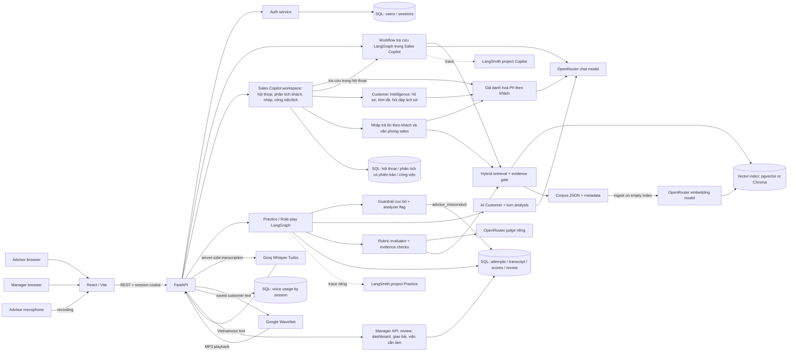

# P-043 — Sơ đồ kiến trúc hiện tại

## Luồng và quyền

1. `POST /api/v1/auth/login` đặt HTTP-only cookie. Practice giới hạn Advisor; review giới hạn Manager. Copilot trên nhánh hiện tại yêu cầu Advisor qua `current_copilot_user`; danh mục scenario cho cả Advisor/Manager. Xem [router Copilot](../src/api/copilot.py) và [router Practice/manager](../src/api/recorded_practice.py).
2. Workflow tra cứu trong Sales Copilot nhận `/api/v1/copilot/query` (hoặc `query/stream` qua SSE), tìm evidence từ corpus/vector index và lexical retrieval, lọc theo metadata và ngày hiệu lực, tạo câu trả lời trích nguồn hoặc abstain. `/api/v1/copilot/sources/{document_id}` mở tài liệu gốc.
   Sales Copilot (`/api/v1/sales-copilot/*`) dùng Copilot trong từng hội thoại khách: hồ sơ và tóm tắt tình hình khách có phiên bản với tin nhắn nguồn, hỏi đáp lịch sử, nháp trả lời theo bối cảnh/văn phong sales, gợi ý công việc/lịch hẹn, dashboard và lịch. PII được giả danh hoá theo khách trước khi gửi model.
3. Advisor chọn [scenario JSON](../data/scenarios/scenarios.json) → tạo state/checkpoint → **Advisor mở lời trước** → guardrail cục bộ → turn analyzer → cập nhật/lưu state → AI Customer → lưu transcript → frontend. Guardrail trong [guardrails.py](../src/agents/roleplay/guardrails.py) và cờ `unsafe_or_abusive` của analyzer là hai lớp phát hiện; khi vi phạm, kết thúc bằng `advisor_misconduct`.
4. Kết thúc phiên → [evaluator chung](../src/agents/roleplay/evaluator.py) nhận transcript + state + scenario + knowledge evidence → judge riêng → validate quote/message ID/nguồn → AI draft trong SQL. `sales-rubric-v4` có 5 tiêu chí (nhu cầu, sản phẩm, phản đối, chính sách, chốt); cấu hình `policy_expectations` nằm trong từng scenario. Judge dùng `PRACTICE_JUDGE_PROVIDER` / `PRACTICE_JUDGE_MODEL` (mặc định OpenRouter / `deepseek/deepseek-v3.2`, temperature 0), tách khỏi generator `OPENROUTER_MODEL_NAME`.
5. SQL lưu ownership, transcript, AI draft và review. Advisor chỉ đọc lịch sử của mình. Manager xem hàng đợi/lịch sử, sửa điểm kèm lý do và duyệt; Advisor xem kết quả đã duyệt. Chỉ bài đã duyệt mới tính vào tiến độ Advisor (`/practice/progress`) và dashboard đội (`/manager/dashboard`: bản đồ kỹ năng, điểm 8 tuần, so sánh điểm AI với điểm Manager).
6. Manager giao bài qua `/manager/assignments` (Advisor, kịch bản, hạn); Advisor thấy trong "Bài được giao", phiên bắt đầu từ bài giao được gắn với bài đó và cập nhật trạng thái `assigned → in_progress → completed`.

## Kịch bản và giọng nói

Bốn kịch bản: `SCENARIO_01_VF5_TAXI`, `SCENARIO_02_VF7_VS_CX5`, `SCENARIO_03_VF6_APARTMENT`, `SCENARIO_04_VF6_ECO_PLUS_UPSELL`. Kịch bản 04 cho phép `close_eco` và `upsell_plus`; upsell là ưu tiên, không phải điều kiện bắt buộc của mọi phiên.

Advisor chọn **Nhắn tin** hoặc **Gọi thoại** khi vào phòng và có thể đổi trong phiên. Micro → push-to-talk (giữ nút hoặc phím Space) tối đa 90 giây → FastAPI → Groq Whisper → bản chép. Công tắc **Tự động gửi** chọn gửi ngay hoặc sửa trước khi gửi. Văn bản Customer → Google WaveNet → phát audio; [voice service](../src/services/voice.py) và SQL usage ở server. [Mã lỗi Practice](../src/api/practice_errors.py) có thông báo tiếng Việt; frontend dùng [notice dialog](../frontend/src/components/common/NoticeDialog.jsx) và [ánh xạ lỗi](../frontend/src/utils/practiceNotices.js) để đưa ra hành động phù hợp.

## Ranh giới MVP

`data/knowledge/corpus.json` là nguồn nội dung demo được kiểm soát; vector index chỉ là dữ liệu dẫn xuất. Docker Compose dùng PostgreSQL + pgvector trong volume riêng của từng máy. Chạy Python trực tiếp vẫn mặc định SQLite + Chroma. Muốn chia sẻ lịch sử cần một backend và database hosted dùng chung. `/health` chỉ đo liveness, không xác nhận provider. Scenario/khách hàng là dữ liệu giả lập; không đưa PII thật vào log, báo cáo hay video.

## Triển khai và tham chiếu

Docker Compose: browser → Caddy/React → FastAPI → PostgreSQL + pgvector với volume local. Chạy trực tiếp dùng SQLite + Chroma mặc định. Hosted ([deployment](deployment.md)): Vercel → Render → Neon, live tại https://aisale.itup.io.vn/. [CI](../.github/workflows/ci.yml) chạy Ruff và pytest backend trên mỗi push/PR. Chi tiết thành phần ở [ARCHITECTURE.md](../ARCHITECTURE.md); hướng dẫn chạy và Live URL ở [README.md](../README.md).
