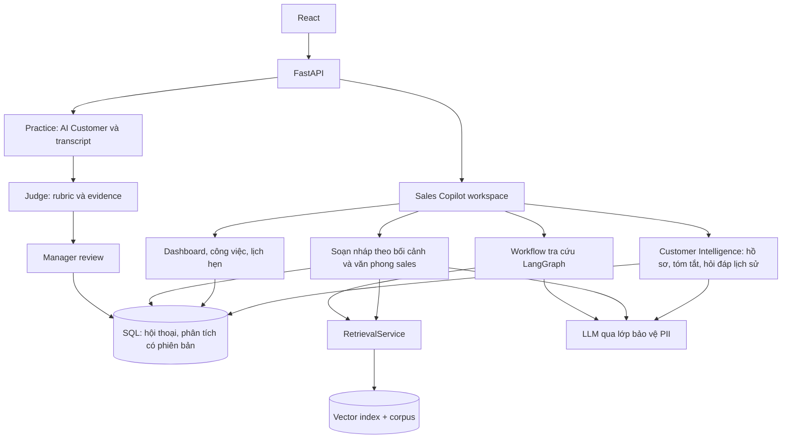

# Product Requirements Document

## 1. Product Overview

**Project:** VFO2O-20 — AI Agent Huấn luyện & hỗ trợ tư vấn viên bán xe (Sales Enablement)
**Product:** VinFast AI Sales Coach & Copilot
**Team:** 043Nova
**Product type:** Internal Sales Enablement Platform
**Primary users:** Sales Advisor, Training Manager

### Product objective

Giúp Advisor chăm sóc nhiều khách qua nhiều ngày mà vẫn nắm đúng bối cảnh, chuẩn bị câu trả lời có nguồn, theo sát công việc và luyện kỹ năng trước khi gặp khách thật. Giúp Manager review transcript/đánh giá và tập trung huấn luyện vào kỹ năng cần cải thiện.

Định vị và bảng đối chiếu giải pháp nằm trong [BRIEF §1–3, §12](BRIEF.md), là nguồn nội dung sản phẩm chi tiết. Hai phần Copilot và Roleplay có pain point/solution riêng dưới đây.

# 2. Problem Statement

## 2.1. Copilot — pain points và solution

**Pain points:** sales trao đổi nhiều khách đồng thời; sau nhiều ngày khó nhớ nhu cầu, ngân sách, xe quan tâm, nội dung đã tư vấn và lời hứa. Thông tin nằm rải trong tin nhắn, tài liệu và công cụ bên ngoài; kiến thức xe/chính sách cần xác minh đúng điều kiện và hiệu lực.

**Solution:** không gian hội thoại theo khách; hồ sơ và tóm tắt có tin nguồn; nội dung đã trao đổi/còn mở; dữ kiện cho sales kiểm tra, sửa/xác nhận; nháp trả lời theo lịch sử và corpus; công việc và lịch hẹn gắn với khách.

**Kết quả hướng tới:** nắm lại bối cảnh thuận tiện, tiếp tục tư vấn phù hợp và theo sát cam kết. Customer Intelligence v2 phụ thuộc cấu hình/khóa PII; không mặc định đã bật trên live. Bàn giao chatbot và đồng bộ Zalo/Facebook chưa tích hợp.

## 2.2. Roleplay — pain points và solution

**Pain points:** nhân viên mới thiếu thực hành, có thể tư vấn sai hoặc thiếu mạch lạc trước khách thật; luyện và nhận xét trực tiếp phụ thuộc thời gian quản lý; khó nhận diện điểm yếu khi thiếu transcript/rubric.

**Solution:** AI Customer theo tình huống VinFast, luyện chữ/giọng nói, Mirror tự quan sát; evaluator tạo đánh giá nháp có dẫn chứng; manager xem transcript, duyệt/sửa, góp ý và giao bài tiếp. Mirror không tự chấm biểu cảm hoặc ghi hình.

**Kết quả hướng tới:** thêm cơ hội luyện và review có trọng tâm. Chưa có phép đo trước/sau xác nhận giảm thời gian, chi phí hoặc tăng doanh thu.

# 3. Personas

## Persona A — Sales Advisor

### Jobs

* chăm sóc nhiều khách, nắm lại hồ sơ và lịch sử sau nhiều ngày;
* chuẩn bị câu trả lời và theo dõi công việc/lịch hẹn theo khách;
* tìm thông tin có nguồn;
* luyện tư vấn;
* xem feedback;
* cải thiện kỹ năng.

### Pain points

* khó nhớ bối cảnh và cam kết của nhiều khách qua nhiều ngày;
* phải đọc lại tin nhắn hoặc hỏi lại khách;
* tài liệu phân tán;
* chính sách thay đổi;
* khó nhớ toàn bộ thông tin;
* không phải lúc nào cũng có trainer để luyện tập;
* khó biết mình cần cải thiện phần nào.

---

## Persona B — Training Manager

### Jobs

* kiểm tra chất lượng đào tạo;
* review kết quả của nhân viên;
* điều chỉnh đánh giá AI khi cần;
* xác định điểm yếu của từng nhân viên và team.

### Pain points

* review thủ công tốn thời gian;
* khó quan sát tất cả các phiên luyện tập;
* feedback có thể không đồng nhất;
* cần kiểm soát kết quả trước khi sử dụng chính thức.

---

# 4. Product Scope

## P0 — MVP Core

### F1. Authentication & Role

Hệ thống có hai role:

```text
Sales Advisor
Training Manager
```

Sau khi đăng nhập:

```text
Sales Advisor
→ Advisor Home

Training Manager
→ Manager Reviews
```

---

### F2. Sales Copilot và tra cứu kiến thức

Phạm vi Sales Copilot gồm hội thoại theo khách, hồ sơ nhu cầu, tóm tắt có tin nguồn, trạng thái vấn đề, nháp trả lời và công việc/lịch hẹn. Contract đang có nằm tại `src/models/sales_copilot.py`, `src/models/customer_intelligence.py`; giao diện tại `frontend/src/components/copilot/CustomerSalesCopilotView.jsx`. Đây là mô tả phạm vi hiện có trong code, không phải xác nhận E2E hoặc deployment.

Yêu cầu sản phẩm:

- Dữ kiện phân biệt ghi nhận/suy luận/mâu thuẫn/đã xác nhận; có nguồn khi phân tích rút ra từ hội thoại.
- Sales được kiểm tra, sửa và xác nhận dữ kiện; phân tích lại phải giữ xác nhận của sales.
- Bản nháp cần sales kiểm tra; hiển thị khi chưa bao gồm tin nhắn mới.
- Công việc/lịch hẹn gắn với khách và có trạng thái để theo dõi.
- Bàn giao tự động chatbot và đồng bộ kênh ngoài là phạm vi cần tích hợp.

#### Tra cứu kiến thức trong Sales Copilot

Advisor có thể hỏi bằng ngôn ngữ tự nhiên về:

```text
Sản phẩm
Thông số xe
Giá
Ưu đãi
Chính sách
Bảo hành
Pin / sạc
```

Flow:

```text
Query
  ↓
Retrieve knowledge
  ↓
Filter relevant/current documents
  ↓
Rerank when benchmark shows a measurable benefit
  ↓
Generate grounded answer
  ↓
Answer + citation
```

Câu trả lời phải hiển thị:

* câu trả lời;
* tên nguồn;
* tài liệu liên quan;
* phiên bản/ngày hiệu lực khi có.

Nếu không đủ evidence:

> Không tìm thấy thông tin đủ tin cậy trong kho kiến thức hiện tại.

Hệ thống không được tự đoán giá, ưu đãi hoặc chính sách.

---

### F3. Knowledge Base

MVP sử dụng corpus được chuẩn bị từ các nguồn VinFast chính thức và tài liệu được team lựa chọn.

Knowledge base cần hỗ trợ:

```text
Product information
Price information
Sales policies
Promotion policies
Warranty
Battery / charging information
```

Metadata cơ bản:

```text
document_id
title
source_url
document_type
vehicle_model
policy_type
published_at
effective_from
effective_to
version
source_hash
content
```

Hệ thống cần phân biệt được:

```text
tài liệu hiện hành
tài liệu cũ
phiên bản tài liệu
thời gian hiệu lực
```

Không xây giao diện cho Manager upload URL hoặc PDF trong MVP.

Việc ingest/update corpus được xử lý bởi pipeline phía backend của project.

---

### F4. Practice Scenario Library

MVP ưu tiên tối thiểu 3 scenario đã được kiểm chứng end-to-end; mục tiêu là 4
scenario nếu scenario thứ tư đạt cùng chuẩn dữ liệu, hành vi và đánh giá. Không
thêm scenario chỉ để đủ số lượng.

Ví dụ:

```text
Price objection

EV / range concern

Competitor comparison

Customer not ready to buy

Need discovery
```

Một scenario có thể chứa:

```text
title
persona
sales_channel
visible_context
hidden_facts
opening_statement
difficulty
reveal_rules
assessment_dimensions
scenario_version
```

Thông tin hiển thị trước phiên chỉ gồm những gì advisor có thể biết hợp lý từ
kênh/giai đoạn bán hàng và tương tác trước đó. Không đưa mục tiêu discovery vào
brief rồi tiếp tục chấm advisor vì đã “khám phá” chính thông tin đó.

Difficulty được chọn trước khi bắt đầu và cố định trong một attempt. Adaptive
difficulty giữa hội thoại là P1.

---

### F5. AI Customer

AI đóng vai khách hàng trong phiên luyện tập.

AI Customer phải:

* giữ đúng persona;
* nhớ conversation history;
* phản ứng theo câu trả lời của advisor;
* không tự đổi scenario;
* không reveal toàn bộ hidden information ngay lập tức;
* tiết lộ thông tin theo semantic intent của câu hỏi, không phụ thuộc một exact
  phrase hoặc keyword duy nhất;
* trả lời câu hỏi rộng bằng lượng thông tin phù hợp thay vì dump toàn bộ hidden
  facts;
* duy trì hội thoại nhiều lượt.

AI Customer không được hiển thị:

```text
system prompt
hidden needs
scenario control logic
scoring logic
```

---

### F6. Conversation Memory

Mỗi practice session phải giữ context xuyên suốt nhiều lượt.

Ví dụ:

```text
Customer → Turn 1

Advisor → Turn 2

Customer → Turn 3

Advisor → Turn 4

...
```

AI Customer phải sử dụng các lượt trước để tạo phản hồi tiếp theo.

Không được coi mỗi message là một conversation mới.

---

### F7. End Practice Session

Advisor có thể chọn:

```text
[End Practice]
```

Mỗi turn được persist trong lúc hội thoại. Sau khi kết thúc:

```text
Persist final turn and freeze transcript
      ↓
Mark evaluation pending
      ↓
Analyze session and factual claims
      ↓
Generate provisional assessment + feedback
      ↓
Validate and save evaluation
```

Provider timeout hoặc malformed evaluator output không được làm mất transcript.
Hệ thống hiển thị trạng thái evaluation failed/retryable riêng với lỗi của advisor.

---

### F8. AI Assessment / Rubric Judge

Sau phiên luyện tập, hệ thống đánh giá advisor theo các tiêu chí được cấu hình.

Assessment bao gồm:

```text
Overall result

Score theo từng skill

Strengths

Areas for improvement

Transcript evidence

Suggested improvement
```

MVP dùng năm chiều: Need Discovery, Product Knowledge, Objection Handling,
Policy Accuracy và Closing / Next Step, thang điểm 1–3 theo `docs/project-management/RUBRIC_V3.md`. Mỗi chiều phải có:

```text
status: ASSESSED | UNASSESSED
observable checks: MET | MISSED | NOT_APPLICABLE | UNCLEAR
score: 1–3 khi status = ASSESSED, ngược lại null
transcript turn IDs + exact quotes
reason
improvement suggestion
```

`UNASSESSED` được dùng khi không có cơ hội hợp lý hoặc thiếu bằng chứng để kết
luận; `reason` phải phân biệt hai nguyên nhân. Nó không bị quy đổi thành điểm
thấp. Overall score do code tính trên các
criterion đã được assessed và phải hiển thị coverage. Không suy diễn phần trăm
năng lực từ thang 1–3 khi chưa có định nghĩa được hiệu chuẩn.

---

### F9. Grounded Fact / Policy Check

Khi advisor đưa ra một phát biểu về:

```text
sản phẩm
giá
ưu đãi
policy
bảo hành
pin / sạc
```

hệ thống có thể sử dụng cùng Knowledge Base để kiểm tra.

Flow:

```text
Advisor statement
       ↓
Extract factual claim
       ↓
Retrieve relevant knowledge
       ↓
Compare with approved sources
       ↓
SUPPORTED
UNVERIFIABLE
CONTRADICTED
       ↓
Provide evidence to assessment
```

Mục tiêu là không để phần factual accuracy phụ thuộc hoàn toàn vào đánh giá chủ quan của LLM Judge.

`UNVERIFIABLE` có nghĩa knowledge base chưa đủ evidence, không tự động kết luận
advisor sai. Mỗi factual finding phải liên kết tới claim trong transcript và
source/version/span khi có. Critical factual error không được che khuất bởi điểm
trung bình cao ở các chiều khác.

---

### F10. Session Review

Sau practice, Advisor có thể xem:

* overall result;
* score theo từng skill;
* strengths;
* weaknesses;
* evidence từ transcript;
* feedback;
* suggested improvement.

Kết quả ngay sau phiên có trạng thái `AI DRAFT — CHƯA ĐƯỢC MANAGER DUYỆT` và
không phải đánh giá nhân sự chính thức. Advisor có thể luyện tập lại hoặc gửi
attempt hiện tại để Manager review. Hệ thống có thể đề xuất một tài liệu hoặc
scenario tiếp theo từ điểm yếu chính; đây là recommendation đơn, không phải lộ
trình học tự động nhiều bước.

Nếu feedback liên quan đến factual information:

```text
Current source
[View Source]
```

Không hiển thị rubric score real-time trong lúc luyện tập.

---

### F11. Session History

MVP lưu:

```text
user
scenario
date/time
transcript
AI assessment
manager review
status
```

Advisor có thể xem:

```text
Latest result on each scenario card
Attempt count per scenario
Scenario attempt history (newest first)
Recent Sessions
Previous Feedback
Basic Skill Summary
Recommended Next Practice
```

---

### F12. Manager HITL Review

Mọi attempt hoàn thành được lưu tự động trong lịch sử của Advisor cùng transcript
và AI assessment. Advisor không cần chọn hoặc submit riêng một attempt để lưu.

Manager có thể truy cập mọi attempt đã hoàn thành. Manager Review Queue mặc định
group theo `advisor + scenario` và ưu tiên attempt mới nhất chưa review; các attempt
cũ vẫn nằm trong history và có thể mở khi cần, nhưng không chiếm các queue item ngang
hàng riêng biệt.

Manager có thể xem:

```text
Transcript

AI assessment

Evidence

Feedback

Recommended next practice
```

Manager actions:

```text
Approve

Edit score / assessment

Edit recommended next practice

Add note / reason
```

Nếu chỉnh sửa, hệ thống lưu:

```text
old value
new value
manager
reason
timestamp
```

AI assessment không được coi là đánh giá chính thức của nhân viên. Mỗi attempt chỉ
trở thành kết quả chính thức sau khi Manager review và approve attempt đó.

---

# 5. Main User Flows

## 5.0. Customer Sales Workspace

Advisor mở khách → đọc hồ sơ và bản tóm tắt hiện có → kiểm tra câu hỏi còn mở, tin nguồn và cam kết → tiếp tục hội thoại → yêu cầu tra cứu hoặc nháp trả lời theo khách → kiểm tra/chỉnh sửa trước khi sử dụng → quản lý công việc/lịch hẹn → yêu cầu cập nhật phân tích khi có tin mới.

Failure/empty states: chưa có hội thoại hoặc phân tích thì hiển thị trạng thái chưa có dữ liệu; có tin mới thì báo phân tích/nháp chưa cập nhật; dữ kiện suy luận hoặc mâu thuẫn cần kiểm tra; không biến đề xuất của AI thành hành động đã được sales xác nhận.


## 5.1. Knowledge Lookup

Advisor tra cứu ngay trong không gian khách (công cụ **Tra cứu** của Trợ lý Co-pilot) hoặc mở **Kho kiến thức**.

```text
Advisor
   ↓
Tra cứu trong không gian khách  ──or──  Kho kiến thức (tìm tài liệu, dòng xe, câu hỏi)
   ↓
Copilot graph: phân tích câu hỏi → lập truy vấn → truy xuất hybrid (vector + BM25)
              → lọc metadata + ngày hiệu lực → chọn evidence
   ↓
Đủ evidence?
   │
   ├── Có → Trả lời (streaming) + citation → mở tài liệu gốc / PDF trong Kho kiến thức
   │
   └── Thiếu hoặc nguồn mâu thuẫn → cảnh báo “cần xác minh”, không khẳng định
```

Câu hỏi ngoài phạm vi kho được từ chối lịch sự và hướng về nội dung hỗ trợ.

---

## 5.2. Practice

```text
Advisor → Phòng luyện tập
   ↓
Xem Điểm của bạn / Bài được giao / Thư viện tình huống / Lịch sử
   ↓
Chọn tình huống (hoặc bài Manager giao) → chọn Nhắn tin hoặc Gọi thoại
   ↓
Xem Bối cảnh khách + Mục tiêu + 5 kỹ năng được chấm
   ↓
Advisor mở lời → AI Customer ↔ Advisor, nhiều lượt (Lượt n / tối đa)
   (Gọi thoại: giữ Space/nút để nói, STT → Tự động gửi hoặc sửa rồi gửi; lời khách đọc bằng TTS;
    Mirror tự quan sát, không ghi hình)
   ↓
Kết thúc: Advisor bấm “Kết thúc & chấm điểm” (sau khi khách đồng ý bước tiếp theo) | hết lượt
          | khách rời đi (lạc đề 2 lượt liên tiếp, băn khoăn không được giải quyết)
          | ngôn từ không phù hợp
   ↓
Freeze transcript → AI judge tạo bản nháp (điểm 1–3 hoặc Chưa chấm, trích dẫn, factual check)
   │
   ├── Lỗi chấm → “Chấm điểm thất bại” → Thử lại (giữ nguyên transcript)
   ↓
Kết quả: “Bản nháp AI (Chờ Quản lý duyệt)” → tự lưu vào Lịch sử
   ↓
Luyện tập lại  OR  Về danh sách kịch bản
   ↓
Manager duyệt → “Quản lý đã duyệt” → cập nhật Điểm của bạn
```

---

## 5.3. Manager Review

```text
Manager → Tổng quan (Cần xử lý hôm nay, Bản đồ kỹ năng, Hàng đợi duyệt)
          or Lịch sử luyện tập (badge số bài chờ duyệt)
   ↓
Hàng đợi: attempt mới nhất chưa duyệt theo Advisor + kịch bản (attempt cũ vẫn mở được)
   ↓
Mở bài: Hội thoại | Điểm và bằng chứng | Kiểm tra thông tin | usage giọng nói
   ↓
┌───────────────┬──────────────────────────┬──────────────────┐
│ Giữ điểm AI   │ Sửa điểm 1–3 + lý do     │ Bỏ qua, bài sau  │
│               │ (bắt buộc khi đổi điểm)  │                  │
└───────┬───────┴────────────┬─────────────┴──────────────────┘
        └──── Nhận xét chung (tuỳ chọn) ────┘
                     ↓
  Duyệt bài này | Duyệt và mở bài tiếp theo  (PATCH /manager/reviews/{id})
                     ↓
  Lưu điểm AI gốc + điểm Manager + lý do + thời gian → manager_approved
                     ↓
  Tiến độ Advisor, bản đồ kỹ năng, điểm đội 8 tuần
                     ↓
  Giao bài tiếp (Giao bài: Advisor, kịch bản, hạn) → Advisor thấy trong “Bài được giao”
```

Manager cũng tạo tài khoản Advisor (mật khẩu khởi tạo, bắt buộc đổi ở lần đăng nhập đầu).

---

# 6. P1 — Advanced

## Multi-step Personalized Learning Path

Dựa trên lịch sử assessment:

```text
assessment history
        ↓
identify weak area
        ↓
recommend scenario
```

Ví dụ:

```text
Objection Handling thấp
        ↓
Recommend Price Objection scenario
```

MVP chỉ cần một recommendation trực tiếp từ điểm yếu chính. P1 mở rộng thành lộ
trình nhiều bước dựa trên lịch sử và kết quả đã được Manager duyệt.

---

## Difficulty Progression

```text
Easy
  ↓
Medium
  ↓
Hard
```

Difficulty có thể thay đổi theo:

* mức resistance của customer;
* số hidden constraints;
* ambiguity;
* số objections;
* mức độ phức tạp của scenario.

Difficulty có thể tăng giữa các attempt. Thay đổi difficulty trong một attempt
được defer để giữ fairness và khả năng so sánh của assessment.

---

## Progress Tracking

Theo dõi thay đổi theo thời gian:

```text
Skill score history

Practice frequency

Scenario history

Improvement trend
```

**Trạng thái: đã triển khai.** Advisor có *Điểm của bạn* và radar 5 kỹ năng (`GET /practice/progress`, chỉ tính bài Manager đã duyệt) cùng lịch sử attempt theo tình huống; Manager có *Điểm đội qua 8 tuần* và ngăn chi tiết từng Advisor.

---

## Know–Do Profile

Phân biệt:

```text
KNOW
Khả năng nắm kiến thức

DO
Khả năng sử dụng kiến thức trong conversation
```

Ví dụ:

| Skill     | KNOW | DO |
| --------- | ---: | -: |
| Product   |   90 | 85 |
| Objection |   88 | 55 |
| Policy    |   52 | 58 |

---

## Team Analytics

Manager có thể xem:

```text
Team skill summary

Common weaknesses

Practice activity

Performance trends
```

**Trạng thái: đã triển khai** trong tab *Tổng quan*: bản đồ kỹ năng Advisor × 5 tiêu chí, điểm đội 8 tuần, độ tin cậy AI chấm so với điểm đã duyệt, hàng đợi duyệt và việc cần làm (`GET /manager/dashboard`, `/manager/overview`, `/manager/advisors`). Manager giao bài theo điểm yếu qua tab *Giao bài* (`POST /manager/assignments`).

---

## Policy Change Detection

Hệ thống có thể kiểm tra khi nguồn policy chính thức thay đổi.

```text
Existing source
      ↓
Check updated source
      ↓
Detect change
      ↓
Update/version corpus
```

Đây là enhancement sau MVP, không phải yêu cầu để hoàn thành Gate 1.

---

## Policy Delta Training

Nếu policy mới thay đổi:

```text
New policy
    ↓
Compare with previous version
    ↓
Extract important changes
    ↓
Create short update
    ↓
Recommend relevant practice
```

---

# 7. Main User Stories

## Advisor

### US-01 — Knowledge Lookup

As a Sales Advisor, I want to ask about current product or policy information so that I can answer accurately.

Acceptance:

* response có source;
* current/version information có thể xác định;
* unsupported question triggers abstention.

---

### US-02 — Practice

As a Sales Advisor, I want to practice against an AI Customer so that I can improve before talking to a real customer.

Acceptance:

* multi-turn conversation;
* AI giữ persona;
* AI nhớ conversation context;
* AI phản ứng theo previous answers.

---

### US-03 — Feedback

As a Sales Advisor, I want detailed feedback so that I know what I should improve.

Acceptance:

* assessment theo skill;
* transcript evidence;
* strengths;
* improvement suggestions.
* trạng thái bản nháp/chính thức;
* mọi attempt hoàn thành được lưu tự động;
* Advisor có thể retry hoặc xem lịch sử các attempt của scenario.

---

## Manager

### US-04 — Assessment Review

As a Training Manager, I want to review AI assessments before using them as official training results.

Acceptance:

* xem transcript;
* xem evidence;
* approve/edit;
* chỉnh đề xuất luyện tập tiếp theo;
* edit history được lưu.

---

### US-05 — Team Skill Gaps

As a Training Manager, I want to see common skill gaps so that I can determine future training priorities.

---

# 8. UX Requirements

## Advisor Navigation

```text
Trợ lý Co-pilot   (mặc định: Dashboard · Khách hàng · Lịch sự kiện)
Phòng luyện tập   (Điểm của bạn · Bài được giao · Thư viện tình huống · Lịch sử)
Kho kiến thức     (dòng xe · tài liệu có ngày hiệu lực · tài liệu gốc/PDF)
```

Phòng luyện tập hiển thị điểm và radar 5 kỹ năng (chỉ tính bài đã duyệt), bài được giao và lịch sử; trang kết quả gợi ý luyện tiếp và nhắc lại kiến thức liên quan.

Main actions:

```text
[Vào phòng luyện tập]   [Luyện tập lại kịch bản này]

[Tra cứu] trong không gian khách · tìm trong Kho kiến thức
```

---

## Manager Navigation

```text
Tổng quan          (cần xử lý hôm nay, bản đồ kỹ năng, điểm đội 8 tuần, độ tin cậy AI chấm,
                    hàng đợi duyệt, việc cần làm)
Giao bài
Lịch sử luyện tập  (badge số bài chờ duyệt)
Tài khoản
```

Hàng đợi group theo Advisor + Scenario, mặc định ưu tiên attempt mới nhất chưa review và cho phép mở lịch sử attempt cũ.

---

## UX Principles

* ít menu;
* một CTA chính trên mỗi màn hình;
* clean modern light UI;
* automotive / premium appearance;
* responsive desktop-first;
* không animation phức tạp;
* không skeletal animation.

---

# 9. AI Architecture

Sales Copilot gồm các service theo khách và một workflow tra cứu LangGraph; không đưa toàn bộ phân hệ vào một graph RAG.



Chi tiết graph và các service tại [Copilot workflow](../copilot-workflow.md), sơ đồ toàn hệ thống tại [architecture_diagram.md](../architecture_diagram.md).


LangGraph được sử dụng cho:

```text
Stateful conversation

Multi-turn role-play

Branching workflow

Evaluation workflow

Manager HITL

Session state
```

Người dùng chọn Trợ lý Co-pilot, Kho kiến thức hoặc Phòng luyện tập từ UI. Trong workflow tra cứu, graph vẫn định tuyến câu hỏi theo nội dung; phân tích khách, nháp trả lời và lịch biểu là các service của workspace.

---

# 10. Data Model — Minimal

Đây là mô hình khái niệm, không phải danh sách tên bảng vật lý. Sales Copilot còn có Customer → Conversation → Messages, Profile Facts, Analysis/Recap có phiên bản và tin nguồn, Task/Appointment, Proposal, Milestone và lịch sử trạng thái. Contract tại `src/models/sales_copilot.py`, `src/models/customer_intelligence.py`; persistence tại `src/integrations/sales_copilot_repository.py`, `src/integrations/customer_intelligence_store.py`.

```text
users

documents

document_chunks

scenarios

practice_sessions

conversation_turns

assessments

assessment_dimensions

manager_reviews
```

Relations:

```text
User
 └── Practice Session
      ├── Scenario + attempt number + started/finished timestamps
      ├── Conversation Turns (message_id ổn định)
      └── Assessment (rubric_version, coverage, review_status)
           ├── Dimension Results + Evidence(message_id)
           ├── Factual Findings
           ├── Recommended Next Practice
           └── Manager Review + Edit Reason
```

Knowledge:

```text
Document
 └── Document Chunks
```

---

# 11. Evaluation

## Workflow tra cứu trong Sales Copilot

Có thể đánh giá ví dụ:

* Recall@K;
* Context Precision;
* Answer Correctness;
* Faithfulness;
* Citation Accuracy;
* Out-of-KB abstention.

---

## AI Judge

Advanced evaluation sử dụng tập transcript được chuyên gia chấm.

```text
Calibration set riêng
       ↓
≥20 held-out expert-labelled transcripts cho advanced claim
       ↓
Expert scores
       ↓
AI Judge scores same transcripts
       ↓
Compare
```

Có thể report:

* MAE;
* exact agreement;
* ±1 score agreement;
* ASSESSED / UNASSESSED agreement;
* evidence-reference correctness;
* critical factual miss rate;
* repeat stability trên fixed transcripts;
* QWK như metric bổ sung khi sample đủ;
* disagreement theo từng skill.

Các transcript dùng để tune rubric/prompt không được tính vào held-out result.
Năm criterion của một transcript không được báo cáo như năm ca độc lập.

---

# 12. Non-Functional Requirements

## Accuracy

Thông tin factual, sản phẩm và policy phải grounded vào knowledge base được phê duyệt.

---

## Freshness

Knowledge system cần hỗ trợ:

```text
Document version

Effective date

Current / previous policy
```

---

## Security

Không commit:

```text
API keys

Database passwords

Sensitive employee information
```

---

## Privacy

Training results là dữ liệu nội bộ.

Chỉ Advisor phù hợp và Manager được cấp quyền mới được truy cập.

---

## Auditability

Hệ thống nên lưu:

```text
Document/source version

AI-generated assessment

Rubric version

Prompt/model version

Manager changes
```

---

## Cost

Nguyên tắc kiểm soát: giới hạn số lượt theo scenario; evaluator chỉ chạy sau khi kết thúc; tra cứu có ngân sách request/call/recovery; tái sử dụng corpus cho tra cứu và kiểm chứng. Tần suất 10 phiên/tuần là định mức tính ngân sách, không phải quota tuần đã triển khai.

### Chi phí API theo định mức sử dụng

Nhóm lập ngân sách cho **10 phiên Roleplay voice/nhân viên/tuần**, **40 giây nói/lượt**, quy mô tính **10 lượt/phiên**. Chi phí gồm analyzer, AI Customer, evaluator, một batch factual dự phòng, embedding, STT/TTS và phân bổ phí credits OpenRouter.

| Hạng mục | USD/nhân viên/tháng trung bình |
|---|---:|
| Roleplay voice | 1,79 |
| Sales Copilot theo định mức sử dụng chi tiết | 2,20 |
| Tổng API | 3,98 |
| Ngân sách cộng 30% dự phòng | 5,18 |

Tổng tính từ số chưa làm tròn; các dòng hiển thị làm tròn đến hai chữ số thập phân.

Kịch bản sử dụng cao **15 phiên/người/tuần**: Roleplay **2,68 USD/người/tháng**, tổng cùng Copilot **4,88 USD**, ngân sách có 30% dự phòng **6,34 USD**. Workload Copilot giữ nguyên; tần suất luyện là định mức ngân sách, không phải quota phần mềm.

Copilot tính trên 5 ngày/tuần, mỗi ngày 10 tra cứu, 20 phân tích+recap, 20 nháp trả lời, 5 hỏi lịch sử và 5 gợi ý công việc. Đây là ngân sách theo định mức, không phải kết quả khảo sát token hoặc hóa đơn production. Không tính phần cứng/hosting, benchmark/test và thuế; không khấu trừ free tier/cache. Đơn giá tra ngày 18/10/2026; tháng tính 52/12 tuần.

Chi tiết nguồn giá, request/token, voice, độ nhạy 8–15 lượt và quy mô 1/10/50/100 nhân viên tại [Dự toán chi phí API](../operating-costs.md). Cần theo dõi usage theo request/model và giây/ký tự voice để đối soát ngân sách; xem riêng chi phí phục vụ người dùng và benchmark/test.

---

# 13. Guardrails

AI Customer không được tạo:

```text
Nội dung kỳ thị

Nội dung tình dục không phù hợp

Tình huống bất hợp pháp

Tấn công cá nhân
```

Knowledge Copilot không được:

```text
Tự tạo policy

Tự đoán giá

Tự đoán promotion

Trả lời chắc chắn khi không có đủ nguồn
```

---

# 14. MVP Priority

## P0 — MVP

```text
Authentication + Role

Sales Copilot: customer conversations, profile/recap, history Q&A, reply drafts, tasks/calendar

Knowledge retrieval + RAG citations

Version / effective-date filtering

Scenario Library

AI Customer multi-turn

Conversation Memory

Assessment after session

Fact / Policy Check

Session Review

Manager Review / Edit / Approve

Automatic attempt history + latest-attempt Manager queue

Session History
```

---

## P1 — Advanced

```text
Multi-step Personalized Learning Path

Difficulty Progression

Progress Tracking            ✓ đã triển khai

Know–Do Profile

Team Analytics               ✓ đã triển khai (kèm Giao bài)

Policy Change Detection

Policy Delta Training

Scenario Generation
```

---

# 15. Explicit Non-Goals

Không xây:

```text
Customer-facing chatbot

Manager URL/PDF upload interface

Voice mode

CRM

Lead generation

Marketing automation

Automatic customer calls

Automatic closing

Automatic payment

Autonomous sales agent
```

---

# 16. MVP Completion Criteria

MVP cần chứng minh được ba luồng chính.

## 1. Sales Copilot

Advisor có thể mở đúng khách, xem hội thoại và hồ sơ/tóm tắt có tin nguồn; kiểm tra hoặc xác nhận dữ kiện; hỏi lịch sử; tạo nháp trả lời theo bối cảnh và chỉnh sửa trước khi sử dụng; theo dõi công việc/lịch hẹn. Phân tích và nháp cần thể hiện tình trạng chưa cập nhật khi có tin mới. Các chức năng Customer Intelligence phụ thuộc cấu hình như mô tả tại F2.

Riêng workflow tra cứu, Advisor có thể:

```text
Ask question

Receive grounded answer

View source

Receive Cannot Verify response when evidence is insufficient
```

---

## 2. Practice

Advisor có thể:

```text
Choose scenario

Have multi-turn conversation with AI Customer

End session

Receive assessment and feedback

Retry or view the scenario's saved attempt history
```

---

## 3. Manager HITL

Manager có thể:

```text
View the latest unreviewed assessment per Advisor + Scenario

Open previous attempts from scenario history

View transcript

View evidence

Approve

Edit

Save review note

Approve/edit recommended next practice
```

---
